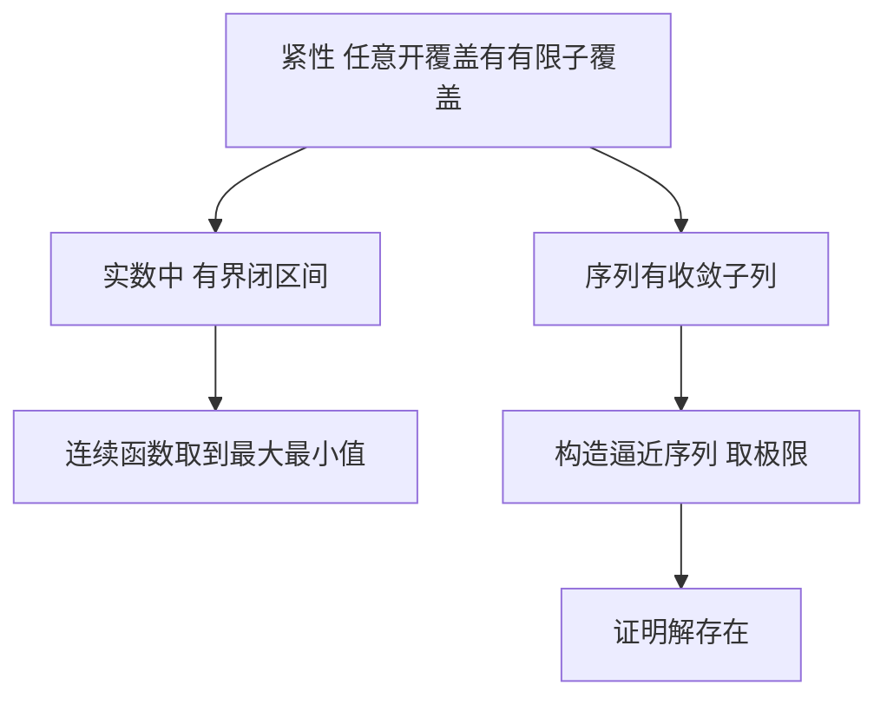

# 紧性与存在性

- **难度**：进阶 | **涉及章节**：第 4 章

## 一句话定义

紧性是说"不会跑到无穷，也不会在边界处丢失点"；它的用途是让"存在"这件事能被证明出来。

## 为什么重要

分析里几乎所有"最大值存在""解存在"的结论都靠它。极值定理、微分方程解的存在性、变分问题的最小元，走的是同一套逻辑。

## 图示

看图说明：左边是定义，中间是它在实数里的具体形态和直接推论，右边是它的用法：先造序列，再取极限。

## 详解

**定义**：空间的任何开覆盖都含有限子覆盖。直观含义是"空间不能无限延伸，也不能在边界处漏点"。

**实数里的判定**：`[a,b]` 紧，`(a,b)` 不紧（开覆盖 `(a+1/n, b−1/n)` 没有有限子覆盖），`R` 不紧。

**用法模板**：要证明某个对象存在，先构造一列逼近的对象，用紧性抽出收敛子列，再证明极限满足要求。这是分析里最常见的三步。

**类比**：紧集像一个封口的盒子。东西放在里面，一定找得到落脚点。失效边界：开区间像个没封口的盒子，东西可以"滑出去"到端点。

## 常见误解

- **别以为紧等于有界**——`R` 中的有界开区间也有界但不紧。
- **别以为紧性是拓扑学里才用的**——极值定理、ODE 解的存在性都靠它。
- **别以为序列紧与开覆盖紧总是等价**——在度量空间里等价，在一般拓扑空间里不一定。

## 在书中出现的脉络

| 章节 | 语境 | 关键结论 |
|---|---|---|
| 第 4 章 | III.3 紧性 | 定义、序列紧、与极值定理的关系 |
| 第 5 章 | IV.10 偏微分方程 | 弱解存在性用紧性 |

## 相关概念

- 前置：开集与连续（第 2、4 章）
- 后续：极值定理（第 4 章）、变分法（第 5 章）
