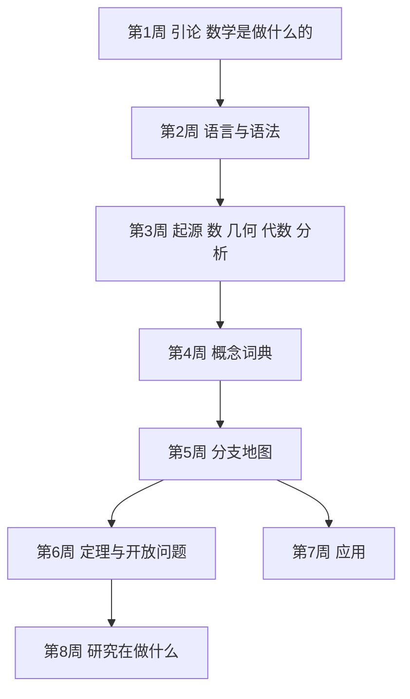

# 学习路径：先建地图，再填内容

面向"知道数学有很多分支，但说不清它们怎么连起来"的读者。终点能力：拿到一个陌生的数学名词或定理，能大致定位它属于哪个分支、在解决什么问题。

## 路径总览

## 步骤 1：数学是做什么的

**目标**：能说清这本书的回答方式，能用三分法粗略归类。
**阅读**：`chapters/ch01-数学是做什么的.md`
**检查点**：给"证明五次方程无根式解"归类并说明理由。
**复习**：卡片标签 `引论`

## 步骤 2：语言与语法

**目标**：掌握集合、函数、关系、运算四件套，能正确使用量词。
**阅读**：`chapters/ch02-数学的语言与语法.md`
**检查点**：能把"所有天鹅都是白的"正确否定。
**复习**：卡片标签 `语法`

## 步骤 3：现代数学的起源

**目标**：讲出数系四次扩张、几何三次转向、分析严格化的脉络。
**阅读**：`chapters/ch03-现代数学的起源.md`
**检查点**：能说明为什么复数是"用序换完备"。
**复习**：卡片标签 `起源`

## 步骤 4：概念的词典

**目标**：掌握基数、紧性、曲率、维、对偶、范畴、亏格、傅里叶变换八个词。
**阅读**：`chapters/ch04-概念的词典.md`
**检查点**：能说出球面与环面为什么不同胚。
**复习**：卡片标签 `概念`

## 步骤 5：分支地图

**目标**：能说出八个分支各问什么问题，以及它们之间谁借谁的力。
**阅读**：`chapters/ch05-数学的各个分支.md`
**检查点**：能解释表示论为什么同时服务数论与物理。
**复习**：卡片标签 `分支`

## 步骤 6：定理与开放问题

**目标**：分清已解决、已证独立、仍开放三类问题。
**阅读**：`chapters/ch06-定理与未解问题.md`
**检查点**：能说明连续统假设的独立性意味着什么。
**复习**：卡片标签 `定理`

## 步骤 7：数学在外面的用处

**目标**：能举出四个领域的实际贡献，并说明"滞后几十年"的模式。
**阅读**：`chapters/ch07-数学的影响.md`
**检查点**：能解释 RSA 依赖什么假设，以及量子计算为何威胁它。
**复习**：卡片标签 `应用`

## 步骤 8：研究在做什么

**目标**：说出五种问题类型与论文的构成。
**阅读**：`chapters/ch08-数学研究在做什么.md`
**检查点**：能判断一个命题属于哪类问题。
**复习**：卡片标签 `研究`

## 学完全程后

- 你能：看到一个新名词，先判断它属于哪个分支、在问哪类问题，再决定要不要深入。
- 你能：把《什么是数学》的推理细节和《数学手册》的公式，放回这张地图上找到位置。
- 综合检验：选一个你不熟的分支（比如表示论），用地图定位它服务谁、依赖谁，再找一条入门条目读一遍。
